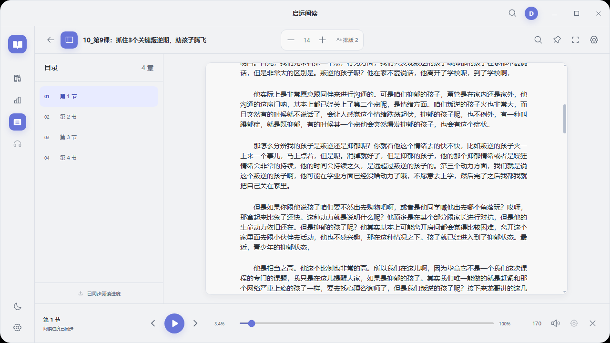

# QYReader（启远阅读）

[简体中文](README.md) | [English](README.en.md)

<p align="center"></p>

启远阅读（QYReader）是面向 Windows 的本地小说阅读器。2.x 桌面版使用 **PySide6 / Qt WebEngine** 承载 React 界面，通过 QWebChannel 调用本地 Python 服务；书架、正文、进度和设置默认只保存在本机。

品牌图标以“展开的书页通向远方晨光”为核心意象，深蓝代表沉静阅读，暖金代表探索与启程。仓库保留高清 PNG 源图，并由其生成包含 16/32/48/64/128/256 像素层级的 Windows ICO。

## 界面预览

内容库：导入文件、粘贴文本或网页正文，按类型、分类和阅读状态筛选内容。


阅读器：左侧章节目录、正文阅读区、顶部排版设置与底部朗读播放条。



独立悬浮朗读窗：纯正文展示与显示控制栏的两种状态。

| 纯正文展示 | 显示控制栏 |
| --- | --- |
|  |  |

## 当前版本能力

### v2.2.0

- 免费离线朗读：设置中心可下载或手动导入 **Kokoro v1.0 INT8 / 普通版（FP32）** 官方模型包，两种版本提供相同的晓北、晓妮、晓晓、晓伊、云健、云希、云夏、云扬声线。入口为“设置 → 朗读与悬浮 → 免费离线音色包 → 模型版本”；先停止朗读，再选择普通版并下载或导入对应模型。普通版下载约350MB，INT8约132MB，切换会保留已下载的模型与原音色；实际生成速度随电脑而异。Edge、SAPI仍保留，共用一个SpeechController / PlaybackService。生成速度不足时显示等待，不自动更换音色。
- 离线生成调度：选定音色后后台预热模型，当前朗读及试听优先于后续预取，已缓存音频直接可用。停止、跳转和模型切换会隔离过时任务；音频缓存采用增量计量，并兼容 Windows 长路径，减少排队和逐句磁盘扫描。
- 划线笔记：选中文字后，在选区附近的小浮条点击四色圆点一键划线，选择“写笔记”打开轻量输入框，或选择“朗读（从选区开始）”。浮条不挤动正文；点击已有划线可查看备注、改色、编辑或删除。保存成功后清除蓝色选区并显示反馈，保存期间防止重复提交。书签面板可定位及导出 Markdown / TXT；旧书签保留，定位使用正文 Unicode 码点，改变字号、行距不改变锚点。
- 阅读统计：主窗口和悬浮窗共用本地统计，显示今日、累计时长及一年热力图。阅读要求正文前台可见且最近5分钟有操作；后台实际播放计听书，生成、缓冲、暂停及试听不计听书。总时长去除阅读与听书的重叠；没有历史数据时从零开始。
- 书架组织：独立内容类型（小说/文章/资料）、单分类、多标签及未读/阅读中/已读筛选。待读为内置标签；首次有效使用进入阅读中，进度100%进入已读，也允许手动锁定状态。重复导入保留进度、书签及未知字段。

新增界面沿用既有主题、控件、圆角和排版。本地源码测试不能证明已安装版本具有这些功能，真实听感仍需人工试听。

- 内容库：读取现有书架、搜索、最近阅读、空状态和自动打开上次阅读内容。
- 内容导入：支持文件选择、粘贴文本和网页链接；文件格式包括 TXT、MD/Markdown、DOC/DOCX、EPUB、MOBI、AZW3、PDF、HTML/HTM、ZIP。
- 文档与网页：Markdown 保留正文，去掉格式符号、图片、链接地址、元数据和代码块；DOC 支持未加密的 Word 97–2003 二进制文档，DOCX 支持正文及表格文字；网页通过 HTTP/HTTPS 提取文章正文并保存本地副本，导入后可离线阅读、朗读、搜索和保存进度。网页不会执行脚本或读取浏览器登录状态，需登录、验证码或动态加载的页面可复制正文后使用粘贴文本。
- 阅读器：章节目录、分块正文、章节跳转、阅读进度、全文搜索、书签、字号、行距和空行模式；正文支持单击或选中文字后从任意字符位置开始朗读，播放条也可一键平滑定位到当前朗读句。
- 朗读：本地 SAPI5 与 Edge 神经语音，共用唯一的 `SpeechController`；支持播放、暂停、停止、上一句、下一句、语速、音量和当前句高亮。Edge 合成失败时会回退 SAPI5 并持续提示，网络恢复后在句子边界自动切回用户选择的音色；本地语音按真实 SAPI 流编号同步文字，暂停恢复会重读当前句，旧语音流的迟到事件不会提前推动下一句。
- 独立悬浮朗读窗：显示上一句、当前句和下一句，与主窗口共享章节、字符偏移、进度和播放状态；主面板可切换到悬浮朗读，悬浮窗可一键返回主面板；支持系统拖动/缩放、置顶、透明度、字体、背景及几何恢复。
- 桌面窗口：自定义标题栏、最小化、最大化、全屏和 100%–200% DPI 适配。Windows 默认使用 Qt 软件合成，优先避免透明窗口内容闪白，启动配置不额外禁用 Chromium GPU；封面悬停仍保留移动与阴影动画。驱动兼容排查可设置 `QYREADER_RENDER_MODE=software`，同时禁用 Chromium GPU；`hardware` 保留交由 Qt 选择的可选路径。
- 应用设置：白天、护眼、米黄、夜间主题，以及启动时自动打开上次阅读内容。

以下入口当前明确不可用，不会创建伪内容：

- 播客、音频导入或语音转写；
- 账号、云同步和在线书城。

旧版 Tk 界面中的整本音频缓存管理等专用页面尚未在 2.x React 界面开放。底层数据和缓存格式仍保留兼容，但不能把“底层代码存在”理解为“当前界面已经可用”。

睡眠定时、章节预生成与缓存管理、统一音色中心、备份恢复和书架批量管理见[后续优化计划](docs/next-optimizations-plan.md)。这些功能由新会话从睡眠定时开始依次实施，不纳入 v2.2.0。

## 更新说明

| 版本 | 主要更新 |
| --- | --- |
| [v2.2.0](release-notes/v2.2.0.md) | 划线笔记改为选区附近的小浮条，四色圆点一键划线，直接查看和编辑已有笔记，保留现有界面风格与数据。 |
| [v2.1.9](release-notes/v2.1.9.md) | 新增可选 Kokoro 普通版提速，优化模型预热、生成排队及缓存，保留 INT8、八种声线与旧数据。 |
| [v2.1.8](release-notes/v2.1.8.md) | 新增可选 Kokoro 离线朗读、划线笔记、阅读统计及分类标签，延续现有界面风格。 |

此处仅保留最新 3 个版本。更早版本请查看 [完整更新历史](CHANGELOG.md) 或 [GitHub Releases](https://github.com/superadminist/QYReader/releases)。每次发布都必须新增 `release-notes/vX.Y.Z.md`，用于生成用户可读的 Release 说明。

## 架构

```text
React 界面（prototype/src）
        │  唯一契约：prototype/src/bridge.d.ts（schemaVersion 2）
        ▼
QWebChannel / DesktopBridge（novelreader/qt_bridge.py）
        │
        ├─ 书架、导入、阅读、设置服务
        ├─ PlaybackService ── 唯一 SpeechController
        └─ FloatingReaderService
                 │
Qt 主窗口 ───────┴────── 独立 Qt 悬浮窗
```

主窗口和悬浮窗使用同一个 Bridge、WebEngine profile、播放服务和 TTS 事件消费入口。正式入口不加载 Tkinter，也不存在隐藏的旧 UI 兼容实例。

## 用户数据与隐私

安装版数据位置（安装目录由用户在安装向导中选择）：

- 书架、设置和阅读进度：`<安装目录>\data\library.json`
- 正文缓存：`<安装目录>\data\cache\`
- 导入源文件备份：`<安装目录>\data\cache\sources\`
- 语音缓存：`<安装目录>\data\tts_cache\`
- 可选离线模型：`<安装目录>\data\models\kokoro\v1.0\int8\` 或同级 `fp32\`（可另选磁盘目录，路径和模型版本保存在 `kokoro-model.json`）
- 阅读与听书统计：`<安装目录>\data\reading_stats.sqlite3`（SQLite事务保存，异常退出不补计离线时间）
- Edge 连接诊断：`<安装目录>\data\logs\edge-tts.log`（轮转保留，不含正文、令牌或完整 URL）

安装版首次启动且 `<安装目录>\data` 不存在时，会把旧版多多朗读的 `%APPDATA%\DDNovelReader` 完整复制到新位置，旧目录不会删除。为兼容已有开发数据，源码运行仍使用该历史目录；测试可继续通过 `DOUBAO_NOVEL_DATA` 指定隔离目录。

应用不会上传书架、正文或阅读进度。只有选用 Edge 在线语音时，朗读文本会按 Edge TTS 的工作方式发送给该服务；本地 SAPI5 不需要网络。

Kokoro只在下载所选模型时访问官方GitHub；安装后合成、试听与播放使用本地文件。INT8压缩包为132,303,094字节，固定SHA256为 `4c3052abaa60943a341f193888cf6abd68787dae6ab8ae5c925a706caa247e4e`；普通版为349,906,910字节，固定SHA256为 `c5f7e2d2caf082bc1d20fb70334a61d99d20b484500aad32e7cf84c128ea3298`。展开模型约181.1 / 382.7 MiB，模型独立于主安装包，升级不重新下载。两种模型及其音频缓存分开保存，每个模型版本的缓存默认限额500 MiB，近期正在使用的音频保留到不再被引用。手动导入必须匹配所选版本，校验失败保留导入原包。

首次新增功能写入前会保留 `library.json.before-reader-features.bak`。统计每5秒保存并在播放阶段切换时提交；异常退出可能损失最后不足5秒，旧阅读进度不会转换成历史时长。

升级安装不会覆盖安装目录中的 `data`，卸载也默认保留它。设置更新会保留现有书籍和未知字段。建议升级前备份 `<安装目录>\data`；不要把真实书架、受版权保护的样书或本地缓存提交到 Git。

## 使用

1. 启动后在“内容库”中选择文件或粘贴文本。
2. 打开书籍，通过目录、滚动或搜索定位正文。
3. 使用底部播放条朗读；`Ctrl+P`/`Ctrl+S` 可暂停或停止，`+`/`-` 调整字号。
4. 使用“悬浮朗读”或 `Ctrl+Shift+F` 打开独立窗口。关闭悬浮窗不会停止朗读；主窗口最小化后悬浮窗仍保持可用。
5. `F11` 或 `Alt+Enter` 切换全屏。
6. 离线合成较慢时，可先停止朗读，在“设置 → 朗读与悬浮 → 免费离线音色包 → 模型版本”选择普通版，再下载或导入约350MB的对应模型；无需删除原 INT8 模型。
7. 选中文字后，在附近的浮条点击颜色圆点划线，或点击“写笔记”输入并保存；点击已有划线可查看、改色、编辑或删除对应笔记。

## 源码开发

### 环境要求

- Windows 10/11；
- Python 3.10+；
- Node.js 20+（仅前端开发、测试和打包需要；打包后的应用不需要 Node.js）。

### 安装 Python 依赖

```bat
install.bat
```

等价的手动命令：

```bat
python -m venv .venv
.venv\Scripts\python.exe -m pip install --upgrade pip
.venv\Scripts\python.exe -m pip install -r requirements.txt
```

### 构建前端

仓库中的桌面宿主只加载静态构建产物，不依赖 Vite 开发服务器。首次运行或修改 `prototype/src` 后执行：

```bat
npm.cmd --prefix prototype ci
npm.cmd --prefix prototype run build
```

产物入口必须存在于 `prototype\dist\client\index.html`。

### 运行桌面应用

```bat
run.bat
```

或：

```bat
.venv\Scripts\python.exe -m novelreader.qt_main
```

`novelreader.main` 只保留为兼容入口，并转发到同一个 Qt 主程序。

### 测试

```bat
.venv\Scripts\python.exe -m unittest discover -s tests -p "test_*.py"
npm.cmd --prefix prototype run test:bridge
npm.cmd --prefix prototype run test:sites
npm.cmd --prefix prototype run build
```

长文本基准：

```bat
.venv\Scripts\python.exe tests\stage3_performance_qa.py
```

Kokoro实测使用自建文本及隔离模型目录，不使用真实书架：

```bat
.venv\Scripts\python.exe tests\kokoro_performance_qa.py --model-dir "隔离目录\models\kokoro\v1.0\int8" --output "仓库外\kokoro-performance.json"
```

脚本比较1/2/4线程的生成耗时、音频时长、RTF和内存，并生成八音色试听文件。它直接测试推理引擎，只适合比较线程和音色，不包含正式服务的模型校验、队列、音频缓存及播放等待。RTF大于1表示该次合成慢于音频播放，增加预取无法持续弥补这一差距。

冷缓存长章节验收使用正式 `KokoroService`，按阅读器相同规则切句，当前句优先，后续预取3句：

```bat
.venv\Scripts\python.exe tests\kokoro_continuity_qa.py --model-dir "隔离目录\models\kokoro\v1.0\fp32" --output "隔离验收目录\cold-chapter.json" --threads 2 --simulate-playback --warm-run
```

默认生成32句自编中文，每句文本唯一；每轮在输出文件旁新建独立数据及缓存目录，根据模型manifest自动选择INT8或FP32变体。模型目录只读，不使用真实书架，也不删除旧验收文件。`--simulate-playback` 按实际WAV时长静默等待，模拟消费者与后台合成同时运行，不打开扬声器。报告包含首句等待、模型加载及校验耗时、每句等待、加权RTF、已缓冲音频秒数、实际生成比例和300毫秒以上的句间等待。至少20句、总音频时长至少200秒、全部未缓存且启动后无超过300毫秒的等待，才能通过脚本的连续性门槛；`--sentences 12` 可做较短回归，但不算长章节通过。

不加 `--simulate-playback` 可缩短基准时间，报告仅包含推理吞吐及乐观的虚拟消费估计，不能证明播放连续。`--warm-run` 单独报告相同文本的缓存回放，要求实际生成次数为零；缓存回放、重复循环和冷章节必须分开判读。输出文件必须使用新路径，详细逐句记录和WAV保留在报告的 `workspace` 路径，便于复核中断的运行。

测量时应避免同时打包或运行其他合成任务。静默模拟和播放事件通过不等于MCI播放、真实扬声器听感或人工音质验证通过。

真实桌面/DPI 验收需要可用的 Windows 图形会话和 Node.js 20+：

```bat
.venv\Scripts\python.exe tests\stage4_desktop_qa.py --node "C:\path\to\node.exe" --screenshot-dir "C:\path\outside\repo\stage4-qa" --dpi 1,1.25,1.5,2
```

截图目录应放在仓库外，避免把测试书架或视觉证据误提交。

## 打包

先安装 Inno Setup 6，再运行以下脚本。它会检查 Node.js 和 Inno Setup、重新构建离线前端、安装固定版本的 PyInstaller，生成快速启动版、单文件兼容版和 Windows 安装包：

```bat
build.bat
```

手动流程为先构建前端、安装打包依赖，再执行：

```bat
.venv\Scripts\python.exe -m pip install -r build-requirements.txt
.venv\Scripts\python.exe -m PyInstaller --clean --noconfirm "QYReader.spec"
```

当前版本的安装包路径为 `dist\installer\QYReader-Setup-2.2.0.exe`。安装向导允许选择安装路径和是否创建桌面图标，默认安装到系统 `Program Files\QYReader`，启动安装程序时会自动请求管理员权限。发布前必须实际完成安装、首次数据迁移、覆盖升级和卸载保留数据验证，并检查 WebEngine 静态资源、导入/阅读、窗口退出清理，以及进程树中不存在 Node、Vite 开发服务器或外部 Python 解释器。仅仅“构建成功”不等于桌面验收通过。

推送到 `main` 后，GitHub Actions 的 `Windows installer` 工作流会在 Windows Runner 上运行测试和完整打包，并将安装包及 `SHA256SUMS.txt` 保存为 30 天有效的构建产物。也可以在 GitHub Actions 页面手动触发该工作流；生成文件不会提交进 Git。

## 目录结构

```text
QYReader/
├─ novelreader/
│  ├─ qt_main.py                 # Qt 正式入口
│  ├─ qt_host.py                 # 主窗口、悬浮窗和离线 WebEngine 宿主
│  ├─ qt_bridge.py               # QWebChannel 边界与事件分发
│  ├─ *_service.py               # 设置、书架、导入、阅读、播放和悬浮窗服务
│  ├─ book_loader.py             # 各格式解析
│  ├─ storage.py                 # 既有本地数据与缓存兼容层
│  └─ tts_engine.py              # SAPI5、Edge TTS、MCI 与 SpeechController
├─ prototype/
│  ├─ src/                       # React 界面与唯一 Bridge 契约
│  ├─ tests/                     # Bridge / Sites 测试
│  └─ dist/client/               # Qt 加载的前端构建产物
├─ tests/                        # Python、Qt、性能与真实桌面验收
├─ installer/QYReader.iss        # Inno Setup 安装器定义
├─ requirements.txt
├─ run.bat
├─ build.bat
└─ QYReader.spec
```

## 已知环境边界

- SAPI5 和真实扬声器播放依赖当前 Windows 用户的语音包、COM 会话和音频设备；CI 或受限桌面会话不能替代实机听音。
- Edge TTS 和断网回退需要分别在联网与断网状态验证。
- 双显示器验收需要真实的第二块屏幕；单屏上的几何单元测试不能替代它。
- 打包后“不依赖本机 Python”的严格证明应在没有 Python/Node 的干净 Windows 环境中完成。

## 许可证

MIT License
