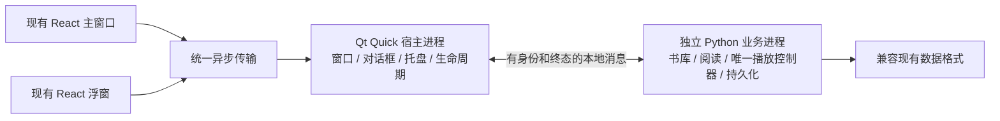

# 阅读器重构：已有成果复用与可用版本交付方案

2026-11-06。当前状态：**代码及证据盘点已完成；本文为实施建议，尚未开始新宿主实现或运行。** 本轮只做盘点、既有纯传输契约检查和方案整理。Tauri 最后收敛已经结束，其暂缓结论、历史失败、NULL 未解释及 P2 未通过的事实全部保留。

## 1. 要交付的产品

交付一个保留当前界面、阅读功能和浮窗体验的 Windows 重构测试版：可以独立解压运行，打开隔离书库，导入书籍、阅读、朗读、切换浮窗，保存进度和笔记，正常退出并再次打开。最终完整候选还必须覆盖已有缓存、睡眠定时、音色、备份恢复、托盘和更新入口。

这次重构的实质改动有三项：

1. 窗口宿主从当前 `QMainWindow + QWebEngineView` 改为 **Qt Quick 窗口 + WebEngineView**，重新验证透明合成、首帧就绪和硬件渲染。React 保留，QML 只承载两个窗口及原生窗口能力。
2. 把书库、阅读、导入、播放与持久化协调放到 **独立 Python 业务进程**。窗口进程不再创建业务实例或播放控制器；两个窗口消费同一业务会话和播放事件。
3. 把现在混合在 `DesktopBridge` 中的业务调度和窗口操作拆开，形成 **明确的异步协议、宿主能力适配与关闭流程**。业务响应处理完成、数据落盘和页面收到结果分别有完成条件。

**建议主线为 React + Qt Quick 新宿主 + 独立 Python 业务进程。** Qt 仍是依赖，但宿主、合成承载方式、进程职责和通信生命周期都改变。菜单和布局调整只能作为整版性能验收中的局部实现，不能替代这三项架构交付。

## 2. 已有成果哪些能复用

下表中的“复用”指复用源码、契约或用例；不表示它们已在新宿主验收。历史成功记录仍受当时 mock、隐藏桌面、禁声和构建版本的限制。

| 成果 | 当前代码与证据 | 进入新版本的方式 | 仍需补齐 |
| --- | --- | --- | --- |
| 生产 React 界面与交互 | `prototype/src/App.jsx`、ReaderFeatures、readerPosition、书架虚拟化、主题和 CSS | 保留视觉、组件、正文偏移和用户操作；主/浮窗加载同一冻结生产构建 | 新宿主事件、窗口变化和实际呈现回归 |
| 阅读和数据服务 | `reader_service.py`、`library_service.py`、`import_service.py`、`storage.py`、`backup_service.py` | 直接复用业务实现，不重写解析、笔记、书籍 ID 和存储格式 | 独立进程中的任务、写入顺序、兼容和异常恢复 |
| 播放与浮窗状态 | `playback_service.py`、`floating_reader_service.py`、`tts_engine.py`、缓存/Kokoro 服务 | 保留唯一 SpeechController、audio-start 推进当前句、三引擎和现有缓存策略 | 从实验禁声服务恢复成正常用户触发播放；真实听音和播放中操作验收 |
| 通用前端传输 | `desktopTransport.js`、`bridge.js`、`bridge.d.ts` | 复用宿主识别、握手、异步调用、事件订阅、断连不落入 demo、dispose 清理 | 新 Qt 传输实现、窗口代际与关闭确认；不能直接使用 Tauri 专属 invoke |
| 独立业务进程原型 | `desktop-lab/service.py` | 复用 JSON-lines 消息格式和已走通的业务调用路径，作为生产化迁移参照 | 目前仍包装 DesktopBridge/WindowPort，带禁声、功能白名单、mock 文件选择和更新响应；不能原样打包 |
| 请求路由与故障用例 | `stdio-client.cjs`、`host_routing_checks.mjs`、`tests/service.test.mjs` | 复用取消/超时/重复 ID、双窗同号隔离、旧会话拒绝等语义及验收场景 | Node/Rust 客户端不直接搬进 Python 宿主；正常关闭还需真正的业务与页面完成确认 |
| 已有业务修复 | 当前 diff 中导入原子替换的有限重试、备份恢复后设置通知、阅读态断连提示 | 保持各自原范围并带入回归，不能在整理时丢掉 | 仍是当前工作区未提交改动；不能当作已发布成果 |
| 夹具和测量基础 | `fixture.py`、书库/正文/缓存校验、请求关联规则、同机测量和原始结果 | 复用 300 本/1000 章数据生成、身份校验、首故障保留和分开的性能/图像测量方法 | 只移植新宿主需要的部分，不复制整套历史诊断链；补新宿主的归属核验 |
| 构建与交付经验 | `QYReader.spec`、`scripts/package_windows.py`、现有离线前端构建 | 复用依赖收集与包结构经验，建立独立重构测试包 | 新入口、业务服务可执行文件、QML 模块和 WebEngineProcess 的干净环境启动验证 |

**仅保留为历史证据、不进入新产品：** Tauri/Tao/Wry 私有补丁、输入指示窗拒绝策略、v25/v26/v27 诊断构建、实验控制命令文件、测试专用 IPC 和菜单探针。Electron 原型保留，不据此自动启动第二条迁移路线。

这次重新读取了当前 Bridge：仍有 42 个公开槽和 14 个事件。AST 还识别出 10 个含直接窗口/对话框调用的方法；这是直接语法调用清单，动态调用等仍需迁移时逐项核对。`readerFeatureAction` 和备份动作中还直接调用 QFileDialog，说明“业务已完全脱离宿主”并未完成。

历史真实业务报告已核对：隔离数据上的文件/粘贴导入、正文定位、分类笔记、共享会话和备份恢复确实执行过；文件选择、更新 HTTP 等仍有 mock。历史路由和断连报告可复用为用例，不能代替新版本验收。本轮重跑的纯传输契约检查通过；没有运行 Qt/Tauri/Electron 宿主或业务服务。

证据索引：[源码与接口盘点](../../my-doc/测试文件/任务20261105-桌面渲染重构/reconstruction-delivery-plan-20261106/source-inventory.json)、[历史报告位置与摘要](../../my-doc/测试文件/任务20261105-桌面渲染重构/reconstruction-delivery-plan-20261106/historical-evidence-inventory.json)、[本轮传输检查](../../my-doc/测试文件/任务20261105-桌面渲染重构/reconstruction-delivery-plan-20261106/transport-check.json)。

## 3. 为什么建议这条路线，以及尚未证明什么

当前 `qt_rendering.py` 在 Windows 默认设置 `QT_QUICK_BACKEND=software`；代码注释说明其目的是规避透明 QWidget/WebEngine 合成中的整帧内容丢失。`qt_host.py` 又承载透明主窗、透明浮窗和角部裁剪。因此，只把业务移到进程外，不能保证解决既有合成开销和闪帧。

已有 Qt 不透明硬件参照在历史隐藏采样中显示过调度改善，这支持继续检查合成路径；它既不是新 Qt Quick 宿主成绩，也不证明透明浮窗、防闪白或当前桌面的体验已经通过。

本机安装的是 PySide6 6.8.3，QtQuick、QtQml、QtWebEngineQuick 和 QtWebEngine QML 模块都存在。Qt 官方提供 Qt Quick 承载网页的 WebEngineView，支持 WebChannel 和透明页面背景。因此可以保持 React 界面并重建薄宿主。[Qt WebEngine 架构](https://doc.qt.io/qt-6.8/qtwebengine-overview.html)、[WebEngineView 接口](https://doc.qt.io/qt-6.8/qml-qtwebengine-webengineview.html)。

**这是有代码与 API 依据的候选路线，还不是性能结论。** Qt Widgets 的 WebEngine 本身也使用 Qt Quick 场景图；“改用 QML”不会自动换掉 Chromium 或保证变快。这里要验证的是直接 Quick 窗口承载后，能否在保持透明圆角和浮窗行为时稳定使用硬件路径，避开现有 QWidget 承载/软件回退的限制。[Qt Quick 场景图](https://doc.qt.io/qt-6.8/qtquick-visualcanvas-scenegraph.html)。

这一最高风险项必须在完整业务移植前完成一次有预算的实现验证。若失败，不用“模块存在”“能显示网页”或“这次未闪白”宣布选型成功。

## 4. 目标边界与拟落地模块

Qt WebEngine 自身的渲染/GPU 辅助进程仍由 Qt 管理，不能把“一个宿主进程”写成应用只有两个 OS 进程。一个业务进程只创建一个播放控制器，浮窗与主窗不能分别持有各自的业务实例。

以下为拟新增位置，**目前不存在对应实现**：

| 模块 | 拟放置位置 | 职责 |
| --- | --- | --- |
| 应用业务协调 | `novelreader/runtime/application.py` | 组合既有服务、管理任务/事件与统一生命周期；允许 QtCore 调度，不依赖 QtWidgets/QML 窗口 |
| 服务入口与协议 | `novelreader/runtime/service_main.py`、`protocol.py` | stdin/stdout 消息、stderr 日志、显式协议握手、业务进程启动与关闭 |
| 异步客户端 | `novelreader/desktop/service_client.py` | GUI 不阻塞的收发、背压、超时、取消、请求终态和服务状态 |
| 宿主能力与关闭协调 | `novelreader/desktop/host_actions.py`、`lifecycle.py` | 对话框、拖动缩放、托盘、外链、用户确认后的安装操作，以及退出顺序 |
| Quick 宿主 | `novelreader/desktop/quick_main.py`、`qml/MainWindow.qml`、`qml/FloatingWindow.qml` | 新窗口与 WebEngineQuick、主题首帧、原生交互与显示状态 |
| 页面传输适配 | `prototype/src/qtServiceTransport.js` | 复用现有 desktopNativeProxy；QWebChannel 只做传输，不暴露完整业务对象 |
| 隔离入口和包 | `run-restructured.bat`、独立打包配置 | 源码启动及可解压运行的测试包；旧 `run.bat` 保留 |

首版不重写书籍解析、语音引擎、React 页面，也不要求去掉 QtCore；这些都不是解除 GUI 与业务耦合的前提。旧入口及其可运行资源保持可回退，新前端构建和 QML 产物输出到独立目录。

### 协议与关闭必须一次设计完整

- 保留业务 `schemaVersion: 2` 语义；传输协议单独显式版本协商。请求身份包含运行会话、页面/窗口代际和请求号，不能只凭本地递增 ID 关联两个窗口。
- 读取、数据写入、后台任务与宿主动作分开登记。写入成功只在实际提交后返回；取消/超时不能伪装成写入回滚，已完成结果不得作为“晚到响应”随意抹掉。
- 文件选择在宿主完成，服务接收验证后的选择结果；不能把 Renderer 传入的任意路径当成用户确认。备份、导出、模型目录、文件定位和更新安装逐项替换实验 mock。
- 主窗最小化/关闭到托盘只改变显示状态，不停止共享服务；应用退出才进入关闭流程。
- 正常退出先关闭准入并让两个页面停止生产请求；完成已接收写入、进度保存和后台任务收尾；确认结果已在页面处理或形成明确终态；再关闭服务和页面、销毁窗口。`pending=0`、业务返回和消息投递成功都不能单独当成最后完成条件。
- 关闭超时、服务异常、页面确认缺失都明确失败并保留已保存/未保存状态，不强制结束进程来算通过。原 15 秒自然退出判据不放宽；Job 清理只算异常兜底，不能算正常退出。
- 客户端采用异步读取/进程事件，不在 GUI 线程调用 `waitForReadyRead`、`waitForFinished` 等同步等待。Qt 官方明确这些调用可能阻塞界面。[QProcess 说明](https://doc.qt.io/qt-6.8/qprocess.html)。

## 5. 四个交付节点

工程预算是集中实现工作量估计，不是已承诺的日历日期；总预算约 **6–9 个集中工作日**，用户安排的可见/听音验收及外部模型/网络等待另计。每个节点必须交可运行产物、剩余缺口和判定；预算用尽不能自动变成下一轮诊断。

| 顺序 / 预算 | 必须交出的东西 | 用户能做什么 | 通过条件与失败处理 |
| --- | --- | --- | --- |
| 1. 新宿主关键能力，最多 1 日 | 冻结源码的主窗/浮窗最小可运行包；加载真实生产 UI，通过隔离业务读取显示真实正文；两窗与退出证据 | 在安排的可见验证中检查原有圆角、文字、透明背景、移动缩放、主浮窗往返 | 核实实际渲染后端、生产资源、双窗样式、无原生错误和自然退出。不得靠全窗 opacity、方角、删动画、关闭沙箱达标。只允许一个有明确修复机制的修正复验；关键能力仍失败就否决 Quick 路线，不扩展业务移植或添加另一个框架候选 |
| 2. 首个可用架构版，2–3 日 | 独立业务进程、Qt 异步适配、新宿主和独立启动入口；核心阅读闭环的可解压测试包 | 文件/文本导入、打开阅读、目录搜索、进度笔记、用户触发朗读、浮窗切换、退出重开 | 数据真实读写、两个窗口共享同一会话与控制器、无 demo 回退，退出时有请求也不丢已接收写入。真实声音未验前标“可运行、待听音”，不能标完整日用版 |
| 3. 功能完整候选，2 日 | 全量功能矩阵、真实宿主能力、缓存/备份/更新流程、独立打包 | 使用现有功能，不再遇到 LAB_FEATURE_NOT_ADAPTED 或测试白名单；托盘、模型目录、文件选择可用 | 现有公开方法、事件及其实际 action 逐项对应；42 个槽并不等于功能全覆盖。不能删减已有功能过关；现有 `audioImport=False` 不新增播客/音频导入 |
| 4. 体验与交付验收，1–3 日 | 固定版本的前后对照、实际桌面/听音记录、干净目录启动结果、回退说明和包摘要 | 解压启动，连续阅读/朗读，保留设置后重开；能够按说明退回旧入口 | 功能完整、性能达标、关键视觉与播放待验清零后，才称重构完成。正式默认入口切换、安装覆盖和发布另行执行，不由测试自动触发 |

节点 1 的可见部分仍由用户安排；若尚未安排，只能先得到“后台能力通过、待桌面呈现”的产物，不能将它当成视觉门槛已过并无条件推进大规模宿主移植。与窗口选择无关的业务协议/接口抽取可以继续，但其工作量计入总预算，不能无限期等待或扩大。

第一份有日常使用意义的重构版本在节点 2 交付，不等全部性能研究结束才第一次给包。它与最终功能完整候选明确区分；若只完成节点 2，不能说整项重构已经交付。若节点 1 被否决，当前建议路线即停止，交付已完成资产与否决说明；不能保证未验证技术必然成功，也不能静默改成菜单优化来冒充完成。

## 6. 第一版和最终版的业务验收清单

### 首个可用架构版

1. 从隔离测试包启动，看到真实书库；没有服务时显示明确错误，不显示 demo 书籍。
2. 导入当前支持的本地书籍或粘贴文本，打开正文、定位目录、搜索、记录进度和笔记；退出重开后结果一致。
3. 用户在可见验收时点击播放/暂停/停止，主窗和浮窗反映同一位置；只在 audio-start 后推进当前句。自动测试保持禁声。
4. 浮窗保持背景透明度与文字独立、自由拖动/缩放、悬停控制及返回主窗；切换不创建另一播放控制器。
5. 在导入、读取和进度保存期间提出退出，结果明确、数据可复核；服务异常时两个窗口显示真实错误，不默默重建播放或继续写入。

### 功能完整候选额外要求

- Edge、SAPI、Kokoro 的现有播放、试听、音色、语速、缓存与睡眠定时行为；实际听音不能用 mock 代替。
- 文件/网页/文本导入、书架组织、批量操作、阅读排版、搜索、书签批注及导出；不新增现有未实现的音频导入。
- 模型文件/目录选择、离线任务、统计、备份预览/恢复/回滚、旧会话失效与设置更新。
- 托盘、最小化和关闭策略、最大化/还原、窗口移动缩放、系统快捷键与更新入口；安装仍须用户动作，不做自动覆盖安装验收。
- 数据兼容使用独立副本，保持书籍 ID、正文偏移、阅读位置、书签笔记、模型/缓存引用；不做格式迁移，不并发打开同一真实书库进行双版本写入。
- 独立包包含 Python/Qt/QML/WebEngine 所需运行时；目标环境不依赖开发机的 Rust、Node、venv 或编译缓存。模型仍按原规则外置。

## 7. 性能与可靠性：沿用门槛，不以换架构名称算完成

固定同机、同数据、同生产资源、视口/DPR/主题，比较现有正式 Qt 与最终新包；菜单不能代表整体体验。沿用原计划的初始工程目标：

| 用户场景 | 合格口径 |
| --- | --- |
| 悬停、设置切换、浮窗短动画 | rAF 帧间隔 P95 ≤ 1.25 个刷新周期，60 Hz 约 21 ms |
| 书库、正文、目录滚动 | 按方向分别报告；原书库/目录目标 P95 ≤ 2 个刷新周期，60 Hz 约 33.4 ms，稳定区间 >50 ms 占比 <1%；正文须至少不回退并报告实测 |
| 输入响应 | 菜单输入至就绪后下一 rAF P95 ≤100 ms；打开书籍、目录、笔记等关键操作分别报告，不用菜单数值替代 |
| 实际窗口体验 | 启动、深色恢复、移动缩放、最大化恢复、主浮窗往返、跨屏与休眠恢复无可复现内容丢失/黑白闪帧；隐藏截图不替代实际呈现 |
| 可靠性 | 关闭时不丢已接收写入、不静默吞业务/原生错误；自然退出、Job/端口无残留；断连不进入 demo、不自动恢复声音 |

先冻结候选，完成受控关闭/取消/断连测试、构建一致性和必要功能验证，再做预登记的有限真实对照。至少三组独立进程的有效成对结果才报告性能趋势；任何当前 NULL、归属、原生错误或退出失败立即停止该批，保留首故障，不替换失败样本。不为凑齐三组而补跑。

同一阻塞最多一次有确定性受控依据的修复复验；不能只因“加了日志”或“本次没复现”延长节点。到预算上限仍无可用证据，必须报告该节点未通过及已可运行的产物。不得将强杀、隐藏错误或放宽判据写成成功。菜单优化可以在证据指向布局开销时纳入节点 4，但不允许单独作为架构交付终点。

## 8. 执行边界与本轮交付

本轮完成的是已有资产盘点与这份具体实施方案；没有实现 Quick 宿主，没有新增业务进程运行，没有开始新的真实性能批次。没有提交、推送、打包发布、覆盖安装或修改 `run.bat`。

旧 Tauri 阶段保持关闭；后续若按本方案实施，作为新的、有交付节点的重构工作，不续写 Tauri 诊断版本。所有旧结论保留；“Qt 菜单/布局独立优化”只是前轮建议，本次用户要求将主线明确收敛到上述架构版本交付。

下一项具体实施任务应是节点 1 的新宿主关键能力包及其受控退出验证，同时冻结核心/宿主接口清单。它的终点是可运行包与明确的通过/否决，不是另一份无限延伸的调查报告。

## 2026-11-06 新宿主关键能力节点：代码与测试包交付，节点未通过

本轮按重构交付方案实施了独立 React + Qt Quick 双窗 + Python 实验业务进程候选，代码在 `restructured/`，源码入口为 `run-restructured.bat --visible`。原正式入口、安装和生产前端资源保持不变。双窗透明/圆角遮罩、异步服务连接、运行/页面/请求身份、页面消费回执、关闭排空与失败保留已实现；实验 sidecar 仍永久禁声并有功能白名单，不能称为生产业务服务。最终包包含 Python/Qt/QML/WebEngine 运行时。

受控响应/关闭契约、生产桥回归、QML/着色器/前端构建通过；直接核对最终 EXE 内嵌 Python 代码和包内生产资源与冻结输入一致。这些不构成实际宿主运行验收。

首批因本轮控制器使用的私有桌面名前缀不符合安全启动器约束，在 CreateProcess 前停止，宿主/服务创建为零。修正前缀有不启动进程的受控反证，测试包不变后只登记一次独立复验。复验实际创建并绑定 Job 后，立即查询主线程桌面的 GetThreadDesktop 返回 NULL、GetLastError 为 0，归属检查失败；宿主业务日志和服务 ready 尚未产生，遂停止。具体空句柄原因未确定，没有追加诊断或绕过归属判据。

复验使用 Job 异常清理，不能算自然退出。停止后只读检查无该包/批次所见进程及端口残留，两批隔离书库前后摘要一致。没有实际图形设备、双窗透明像素、真实正文/共享会话或真实关闭写入通过证据；实际呈现、系统拖缩、DPI/跨屏、声音仍未验。

**节点 1 未通过，本次 Quick 候选按约定否决并停止，不具备进入“首个可用架构版”的条件。** 这是当前交付与证据结论，不能外推为 Qt Quick 技术已被证明不可行。首批和唯一修正复验均已结束，不再补跑。本轮没有重启 Tauri、转向其他框架、做旧 P2 A/B、进入后续节点，也没有提交、推送、发布或覆盖安装。

[本轮交付结果与完整未验清单](../../my-doc/测试文件/任务20261105-桌面渲染重构/quick-host-node1-20261106/交付结果.md) · [最终测试包目录](../../my-doc/测试文件/任务20261105-桌面渲染重构/quick-host-node1-20261106/build-04/product/QuickReaderNode1/) · [可解压包](../../my-doc/测试文件/任务20261105-桌面渲染重构/quick-host-node1-20261106/QuickReaderNode1-node1.zip) · [内嵌代码与构建一致性](../../my-doc/测试文件/任务20261105-桌面渲染重构/quick-host-node1-20261106/build-04/embedded-build-audit.json) · [首批失败](../../my-doc/测试文件/任务20261105-桌面渲染重构/quick-host-node1-20261106/batch-01/result.json) · [唯一复验失败](../../my-doc/测试文件/任务20261105-桌面渲染重构/quick-host-node1-20261106/batch-02-only-retry/result.json) · [停止后只读检查](../../my-doc/测试文件/任务20261105-桌面渲染重构/quick-host-node1-20261106/post-stop-audit.json)。
